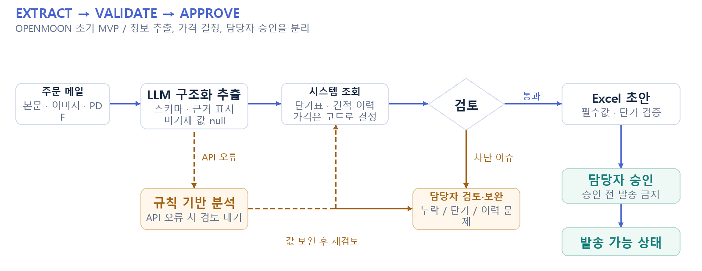

# OPENMOON / yullinmoon

**LLM 구조화 추출과 검토 절차를 결합한 견적 업무 보조 시스템**

주문 메일과 첨부파일에서 필요한 정보를 추출하고, 과거 견적·현재 단가표를 근거로 검토 가능한 견적 초안을 만드는 업무용 AI 서비스입니다.

2026.08.03 - 2026.09.07 | 기업협력 인턴 · 3인 팀 | 초기 MVP 단독 구현 · 상담 Agent 확장  
`Python · FastAPI · Pydantic · SQLAlchemy · SQLite · React · TypeScript · OpenAI / Anthropic`

[구성도 SVG 원본](docs/portfolio/architecture.svg)

## 본인 기여

초기 MVP를 단독 구현했습니다. 이후 팀 시스템에 전체 업무 상담 Agent를 추가하고 대화 맥락과 견적 변경 흐름을 보완했습니다. 사내 PC 기반 LAN 접속, NAS 연결과 사용 안내도 맡았습니다.

## 기술 구조

| 구성 | 구현 내용 |
|---|---|
| Structured Outputs | Pydantic의 고정 스키마로 고객·품목·규격·수량·요청 유형을 추출합니다. 필드별 근거를 메일 본문·첨부·불명으로 구분하고, 없는 값은 추정해서 채우지 않도록 지시합니다. |
| 도구를 통한 업무 처리 | 초기 MVP의 추출·가격 조회 구조를 바탕으로 팀 버전은 회사 지식·장기기억·과거 견적·단가표를 조회하는 Agent로 확장했습니다. 견적 수정과 Excel 초안 갱신은 검토 상태를 확인한 뒤 반영합니다. |
| 대화 맥락과 모델 연결 | 최근 대화, 긴 대화 요약, 저장된 업무 기억을 함께 전달합니다. 팀 버전은 OpenAI·Anthropic 경로를 제공하고, OpenAI 전체 상담 경로에는 웹 검색을 연결했습니다. |
| 검토·오류 대응 | 필수값 누락·단가 불일치·이력 연결 실패는 검토로 넘깁니다. API 오류 시 규칙 분석으로 전환하고 담당자 승인 전에는 발송하지 않습니다. 전달 메일 파싱과 가격 조회 테스트도 구성했습니다. |

## 구현 결과와 확인 범위

대화 테스트에서 앞서 말한 조건을 후속 답변에 반영하는 것을 확인했습니다. 추가 서버 비용 없이 사내 직원들이 공동 접속할 환경을 구성했습니다.

이 저장소는 초기 MVP입니다. 상담 Agent·장기기억·다중 공급자 기능은 [후속 팀 버전](https://github.com/a77315829-byte/yullinmoondesign_)에서 확인할 수 있습니다. 시간 단축률이나 정확도 향상을 실측한 수치는 없습니다.

## 코드와 실행

[구조화 추출](backend/app/services/llm_service.py) · [검토 처리](backend/app/services/review_service.py) · [단가 조회](backend/app/services/price_service.py) · [견적 생성](backend/app/services/quotation_service.py)

설치, 메일 계정·API 연결 및 발송 설정은 [실행 문서](README_DETAILS.md)에 정리했습니다. 공개 설명에는 실제 고객 자료를 포함하지 않습니다.

화면·구성도는 설명을 위한 자료이며, 구성도는 현재 코드의 처리 흐름을 정리한 것입니다. 실험 수치와 본인 기여 범위는 위에 명시한 기준으로 해석합니다.
